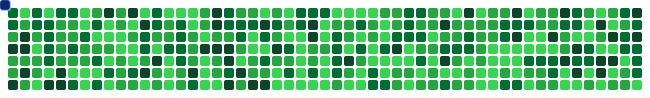

<!-- Header -->

  

<!-- Typing animation -->

  

  
  
  
  

---

## 👋 About me

ICT Engineering student at **SUP'COM** (Tunis). I learn by building: I design distributed backends and AI-powered systems — **microservices and event-driven architectures**, **RAG and GraphRAG** pipelines over **Postgres/pgvector and Neo4j** — and I make them **observable**, so they can be trusted and debugged in production.

- 🔭 Currently building **FinSight** — a 7-service personal-finance platform with a transactional outbox, idempotent Kafka consumers, an AI assistant, and full observability
- 🧠 Deep in **distributed systems & observability** — OpenTelemetry, distributed tracing, Prometheus/Grafana, structured logging — and **GraphRAG over Neo4j** for grounded, explainable answers
- 🏆 **1st place** at CSTAM 3.0 Velodoc (Team Claimix) and the FinTech Hackathon; **2nd place** at Astropreneur 2.0 (Team 7ezb Stage)
- 🎯 Looking for a **6-month PFE / research internship starting February 2027**

## 🏆 Hackathons

| Result | Event | Project |
|---|---|---|
| 🥇 **1st** | CSTAM 3.0 Velodoc Challenge | ClaimGuard AI — healthcare claims pre-validation (Team Claimix) |
| 🥈 **2nd** | Astropreneur 2.0 | AstraRH — 11-agent AI HR platform with human-in-the-loop (Team 7ezb Stage) |
| 🥇 **1st** | FinTech Hackathon — IHEC Carthage | AI algorithmic trading assistant (backend) |
| 🥇 **1st** | Software for Sustainability Ideathon | National Student-Entrepreneur Status (PEEC Carthage) |
| 🥉 **3rd** | Hack4UCAR | ACM ENSTAB × University of Carthage |

## 🛠️ Tech stack

  

| Area | Technologies |
|---|---|
| **Backend** | Java (Spring Boot, Spring Cloud, JPA/Hibernate), Python (FastAPI), REST API design |
| **Distributed systems** | Microservices, Spring Cloud Gateway, Eureka, Feign, Resilience4j, Kafka, RabbitMQ |
| **AI / Data** | RAG, **GraphRAG**, **knowledge graphs (Neo4j)**, Spring AI, LLM integration, embeddings, pgvector |
| **Data** | PostgreSQL (indexing, Flyway), **Neo4j**, Redis |
| **Observability** | **OpenTelemetry, distributed tracing, Prometheus + Grafana, Zipkin, structured logging** |
| **DevOps & Security** | Docker, GitHub Actions CI/CD, JWT, OAuth2, RBAC |

## 🚀 Featured projects

| Project | What it does | Stack |
|---|---|---|
| [**FinSight**](https://github.com/wassimhajjijunior/FinSight) | 7-service finance platform: Transactional Outbox, idempotent Kafka consumers, JWT gateway, RAG assistant with tool calling, and Prometheus/Grafana/Zipkin observability | `Spring Boot` `Kafka` `PostgreSQL` `Spring AI` `Redis` `Docker` |
| **ClaimGuard AI** · 🥇 Velodoc | Healthcare claim pre-validation: **15 versioned checks**, source-linked findings, correction guidance, and a **tamper-evident audit trail**; I owned the observability layer (OpenTelemetry, fail-open, privacy-safe telemetry) | `FastAPI` `PostgreSQL` `OpenTelemetry` `Next.js` `Docker` |
| **AstraRH** · 🥈 Astropreneur 2.0 | 11-agent AI HR platform: reads CVs with proof, triages the inbox, books interviews, plans onboarding, and runs Tunisian payroll — **a human approves every decision** | `Multi-Agent` `LLM` `RAG` `Observability` `Docker` |
| [**AI Tender Automation**](https://github.com/wassimhajjijunior/AI-Tender-Automation) | Semantic search over tender PDFs with grounded LLM answers, DDD service decomposition | `Spring Boot` `RabbitMQ` `RAG` `pgvector` `Docker` |

> 📌 Pin these repos on your profile for the best presentation.

## 📊 GitHub stats

  

## 🐍 Contribution snake

  

## 🤝 Let's connect

I'm happy to talk about **backend architecture, observability, and RAG/GraphRAG systems**. Feel free to reach out on [LinkedIn](https://www.linkedin.com/in/hajji-wassim/) or by [email](mailto:wassim.hajji.whi@gmail.com).

  

