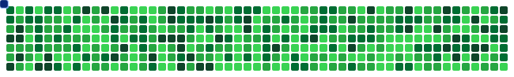

<!-- Header -->

  

<!-- Typing animation -->

  

  
  
  
  

---

## 👋 About me

ICT Engineering student at **SUP'COM** (Tunis). I learn by building: I design distributed backends and AI-powered systems, from **microservices and event-driven architectures** to **RAG pipelines** that give grounded answers over real data.

- 🔭 Currently building **FinSight**, a 7-service personal-finance platform with an AI assistant
- 🧠 Studying **Deep Learning & Data Science**, and drawn to **privacy-preserving ML** (federated / split learning) and **explainable AI**
- 🏆 1st place at the FinTech Hackathon (IHEC Carthage) and at the Software for Sustainability Ideathon
- 🎯 Looking for a **6-month PFE / research internship starting February 2027**

## 🛠️ Tech stack

  

| Area | Technologies |
|---|---|
| **Backend** | Java (Spring Boot, Spring Cloud, JPA/Hibernate), Python (FastAPI), REST API design |
| **Distributed systems** | Microservices, Spring Cloud Gateway, Eureka, Feign, Resilience4j, Kafka, RabbitMQ |
| **AI / Data** | RAG pipelines, Spring AI, LLM integration, embeddings, pgvector, Deep Learning basics |
| **Data** | PostgreSQL (indexing, Flyway), Redis |
| **DevOps & Security** | Docker, GitHub Actions CI/CD, Prometheus + Grafana, Zipkin, JWT, OAuth2, RBAC |

## 🚀 Featured projects

| Project | What it does | Stack |
|---|---|---|
| [**FinSight**](https://github.com/wassimhajjijunior/FinSight) | 7-service finance platform: Transactional Outbox, idempotent Kafka consumers, JWT gateway, RAG assistant with tool calling | `Spring Boot` `Kafka` `PostgreSQL` `Spring AI` `Redis` `Docker` |
| [**AI Tender Automation**](https://github.com/wassimhajjijunior/AI-Tender-Automation) | Semantic search over tender PDFs with grounded LLM answers, DDD service decomposition | `Spring Boot` `RabbitMQ` `RAG` `pgvector` `Docker` |

> ✏️ Replace the two repo links above with your real repository names (or simply pin these repos on your profile).

## 📊 GitHub stats

  

## 🐍 Contribution snake

  

## 🤝 Let's connect

I'm happy to talk about backend architecture, LLM/RAG systems, or ML research opportunities. Feel free to reach out on [LinkedIn](https://www.linkedin.com/in/hajji-wassim/) or by [email](mailto:wassim.hajji.whi@gmail.com).

  

